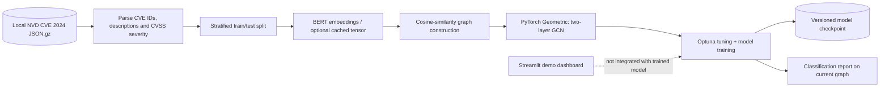

# ThreatNetAPI — Graph-Based CVE Severity Research Prototype

**An experimental graph-neural-network pipeline for classifying recorded software vulnerabilities by severity.** The code parses a local NVD CVE feed, encodes vulnerability descriptions, builds a similarity graph and trains a two-layer graph convolutional network (GCN). Optuna provides a small hyperparameter-search experiment.

> **Important:** Despite the repository name, the present implementation **does not demonstrate zero-day vulnerability discovery**. It is a CVE-severity research prototype using known records. A production REST inference API is **not currently implemented**; the separate Streamlit dashboard presents illustrative/demo data.

## Current scope

| Area | Present in repository | Current limits |
| --- | --- | --- |
| CVE ingestion | Reads `data/raw/nvdcve-1.1-2024.json.gz` | Uses the older NVD 1.1 JSON feed format |
| Labels | Extracts CVSS v3 severity labels (LOW/MEDIUM/HIGH/CRITICAL) | Some CVEs have UNKNOWN/missing severity |
| Feature extraction | `bert-base-uncased` description embeddings | Model download/cache and CPU/GPU requirements |
| Graph representation | Cosine-similarity edges via PyTorch Geometric `Data` | Small-sample, pairwise graph construction; graph may be sparse |
| Model | Two GCN layers, dropout, four-class output | No measured independent test-set score published |
| Search | Optuna explores hidden size, dropout and learning rate | Current tuning evaluates the training graph |
| Interface | Standalone Streamlit demonstration | Metrics/plots use placeholder values, not trained GNN output |

## Architecture



For the module-level flow and **validation caveats**, see [docs/architecture.md](docs/architecture.md).

## Try the experiment

The Python training entry point is inside `zero_day_ai_project/`, **not** at the repository root.

```bash
git clone https://github.com/Dheeraj1301/ThreatNetAPI.git
cd ThreatNetAPI
python -m venv .venv
# Linux/macOS: source .venv/bin/activate
# Windows PowerShell: .venv\Scripts\Activate.ps1
python -m pip install -r requirements.txt
python -m pip install pandas numpy matplotlib transformers optuna
cd zero_day_ai_project
python main.py
```

The repository's `requirements.txt` does not yet include every imported dependency (`transformers`, `optuna`, `pandas`, `matplotlib`). PyTorch Geometric and BERT installation may require additional platform-specific setup. The run also assumes the bundled NVD feed and cached embeddings are compatible with the processed training rows.

The experiment currently limits the loaded feed to the first **1,000 CVE items** before processing. It creates graph features, runs an Optuna study, trains a GCN and writes model checkpoints to `results/model_logs/`.

The standalone illustrative dashboard can be launched separately from the same directory:

```bash
python -m streamlit run app.py
```

**Do not treat dashboard example loss curves, metrics, or severity predictions as measured GNN outputs.** Its controls and plots are currently demonstrative.

## Repository structure

```text
zero_day_ai_project/
├── main.py                   End-to-end experiment script
├── app.py                    Separate Streamlit demonstration
├── src/
│   ├── data_ingestion.py     NVD 1.1 file loader
│   ├── preprocessing.py      Severity extraction and stratified split
│   ├── embedding.py          BERT description features
│   ├── graph_builder.py      Cosine-similarity graph construction
│   ├── model_gnn.py          GCN model, fit and evaluation
│   └── hyperparameter_tuning.py  Optuna study
├── data/raw/                 Source NVD example file
├── data/processed/           Cached embeddings
└── results/model_logs/       Saved model files
```

## Methodology and current validation gaps

The `main.py` workflow creates a stratified split but builds and evaluates the graph from **training rows**. Optuna also scores candidate configurations using the **same graph** rather than a separate validation partition. Therefore the printed classification report is **not a held-out generalization metric**, and no benchmark accuracy should be claimed from it.

Before describing the model as capable of detecting unseen vulnerabilities, the project would need:

1. Correctly aligned embeddings and labels after filtering missing/unknown severities, plus safeguards for graphs with no edges.
2. Leakage-free train/validation/test evaluation on chronologically separated CVEs, class-imbalance analysis and repeatable seeds.
3. Clear held-out macro-F1, recall, confusion matrix and classical text-classifier baselines.
4. An actual authenticated inference API and a dashboard connected to the saved model, with tests.
5. A separate experimental definition and evidence for any claim of previously unknown (“zero-day”) vulnerability detection.

## Technologies

Python, PyTorch, PyTorch Geometric, scikit-learn, BERT/Transformers, NetworkX, Optuna, Streamlit.

## License

[MIT](LICENSE).
