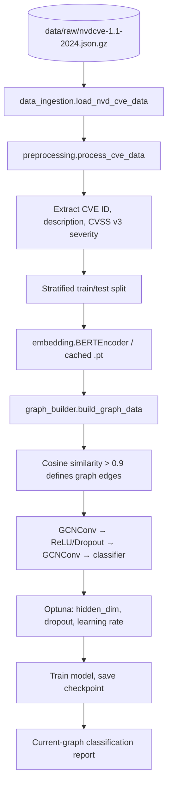
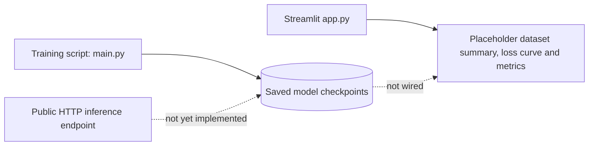

# ThreatNetAPI — Architecture and Experiment Boundaries

ThreatNetAPI is presently a **CVE severity classification experiment**, not a live vulnerability scanner or deployed inference service. It reads a historic NVD feed and uses text similarity to build a graph for learning severity labels.

## Training flow

## Experimental UI separation

## Module boundaries

| Module | Role |
| --- | --- |
| `src/data_ingestion.py` | Reads NVD JSON 1.1 from a compressed file |
| `src/preprocessing.py` | Creates a DataFrame of descriptions and severity classes; performs a split |
| `src/embedding.py` | Downloads/uses BERT and computes/caches dense text embeddings |
| `src/graph_builder.py` | Produces PyTorch Geometric feature, edge and label tensors |
| `src/model_gnn.py` | Trains a two-layer graph convolutional classifier |
| `src/hyperparameter_tuning.py` | Uses Optuna to search training-graph macro-F1 |
| `app.py` | Standalone illustrative dashboard rather than integrated predictions |

## Accuracy and reproducibility warnings

- The held-out test DataFrame created in `main.py` is **not evaluated**; training and scoring reuse the graph. Do not claim test accuracy or zero-day detection.
- Filtering unknown labels after computing embeddings can misalign nodes and labels. Verify that rows are reindexed consistently.
- The edge-construction code may produce an empty graph and requires handling for such cases.
- The Streamlit plots are procedurally generated demo content; they do not reflect the GCN's measured learning curves.
- The dependency manifest is incomplete and the NVD 1.1 feed schema is historical. For reliable replication, pin compatible environments, record seed/data provenance and publish a separate, properly held-out evaluation.

[Return to README](../README.md).
